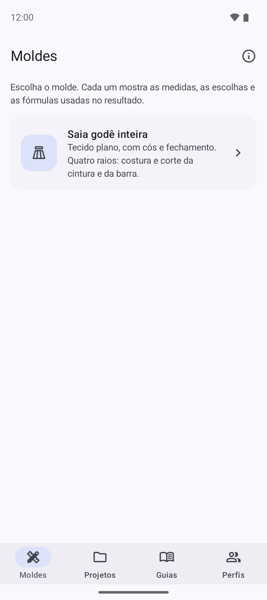
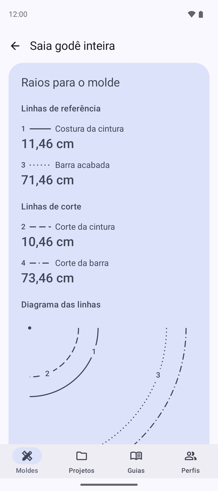
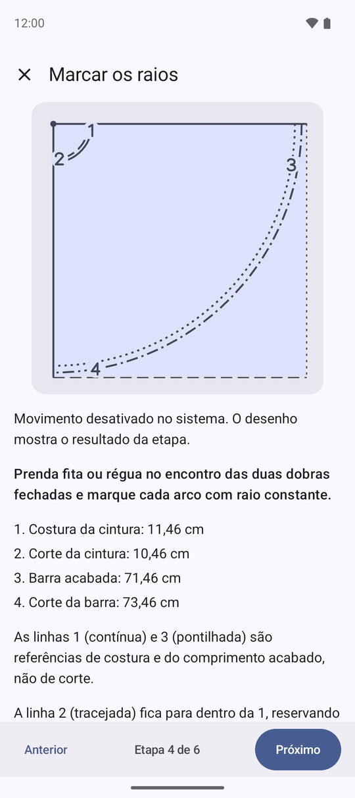
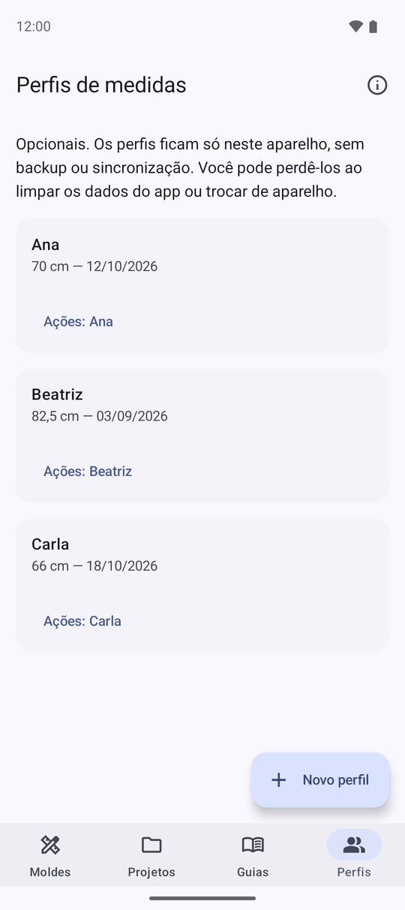

# Molda

[](https://github.com/almeidajr/Molda/actions/workflows/ci.yml)
[](https://sonarcloud.io/summary/new_code?id=almeidajr_Molda)
[](https://github.com/almeidajr/Molda/releases)
[](LICENSE)

Molda is an Android app for sewists who draft patterns on paper. It turns body
measurements into clear, checkable drafting dimensions, shows the formulas
behind every result, and keeps measurements for the people you sew for.

The app is in Brazilian Portuguese and uses centimetres.

| Moldes                                                                                                     | Saia godê                                                                                                                                       | Guia de dobra                                                                                                                                                           | Perfis                                                                                                                     |
|------------------------------------------------------------------------------------------------------------|-------------------------------------------------------------------------------------------------------------------------------------------------|-------------------------------------------------------------------------------------------------------------------------------------------------------------------------|----------------------------------------------------------------------------------------------------------------------------|
|  |  |  |  |

## Features

- **Full-circle skirt calculator:** enter waist, ease, finished length and seam
  allowances to get the four radii to mark: waist and hem, sewing and cutting
  lines, with the formulas used.
- **Fabric-folding guide:** an animated, step-by-step guide from flat fabric
  through folding, marking, cutting and unfolding, drawn to the proportions of
  your calculation.
- **Perfis:** save measurement profiles and fill the calculator from one.
- **Projetos:** save a calculation as a named project. It keeps its measurements
  and results even if the profile changes later.
- **Adaptive layout:** navigation bar on phones, rail and list-detail panes on
  tablets and foldables.

Results are a starting point: check the measurements and make a test garment
before cutting your fabric.

## Status

Molda is in beta. Signed beta builds are published as
[GitHub pre-releases](https://github.com/almeidajr/Molda/releases); they need
Android 16 (API 36) or newer. The fabric-folding guide still needs a practical
trial with a sewist before the first stable release; see the
[roadmap](docs/roadmap.md).

## Feedback

Report bugs, accessibility barriers and ideas through
[GitHub Issues](https://github.com/almeidajr/Molda/issues/new/choose). See
[ACCESSIBILITY.md](ACCESSIBILITY.md) for our accessibility commitments.

## Build and contribute

Molda is built with Kotlin, Jetpack Compose and Material 3, Navigation 3,
Room and Rive. With Android SDK platform 37.2 and JDK 25:

```powershell
.\gradlew.bat :app:installDebug
```

[CONTRIBUTING.md](CONTRIBUTING.md) covers setup, checks, commit conventions and
releases. Product and design rationale live in [docs](docs), domain terms in
[GLOSSARY.md](GLOSSARY.md), and specifications in
[GitHub Issues](https://github.com/almeidajr/Molda/issues).

## License

Copyright 2026 José Rogério de Almeida Júnior. Licensed under the
[Apache License 2.0](LICENSE).
