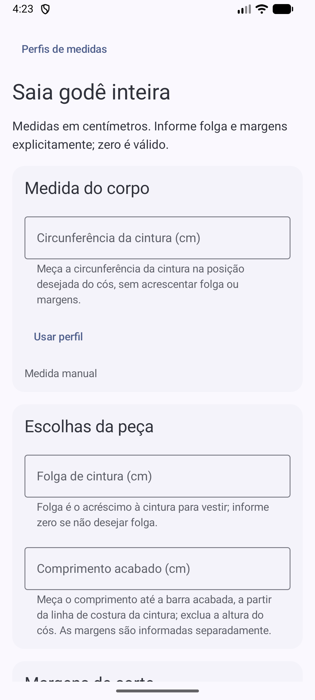

# Calculator palette and contrast evidence

Generated before control implementation with Google Material Color Utilities 0.4.0.
Seed `#67506B`; TONAL_SPOT, 2021 role specification, standard contrast (0).
HCT palettes: primary seed hue/chroma 36; secondary seed hue/chroma 16;
tertiary hue 145/chroma 20 (sage); neutral hue 80/chroma 6 and neutral variant
hue 80/chroma 8 (linen). Runtime dynamic color and system appearance stay enabled.

| Role | Light | Dark |
| --- | --- | --- |
| primary | #784f82 | #e7b6f0 |
| onPrimary | #ffffff | #462151 |
| primaryContainer | #fbd7ff | #5f3869 |
| onPrimaryContainer | #5f3869 | #fbd7ff |
| inversePrimary | #e7b6f0 | #784f82 |
| secondary | #6a596c | #d6c0d6 |
| onSecondary | #ffffff | #3a2b3d |
| secondaryContainer | #f2dbf3 | #514154 |
| onSecondaryContainer | #514154 | #f2dbf3 |
| tertiary | #4f644a | #b5cdae |
| onTertiary | #ffffff | #22351f |
| tertiaryContainer | #d1e9c9 | #384c34 |
| onTertiaryContainer | #384c34 | #d1e9c9 |
| background | #fff8f3 | #17130b |
| onBackground | #201b13 | #ece1d4 |
| surface | #fff8f3 | #17130b |
| onSurface | #201b13 | #ece1d4 |
| surfaceVariant | #eee0cf | #4e4539 |
| onSurfaceVariant | #4e4539 | #d2c5b4 |
| surfaceTint | #784f82 | #e7b6f0 |
| inverseSurface | #352f27 | #ece1d4 |
| inverseOnSurface | #fbefe2 | #352f27 |
| error | #ba1a1a | #ffb4ab |
| onError | #ffffff | #690005 |
| errorContainer | #ffdad6 | #93000a |
| onErrorContainer | #93000a | #ffdad6 |
| outline | #807667 | #9a8f80 |
| outlineVariant | #d2c5b4 | #4e4539 |
| scrim | #000000 | #000000 |
| surfaceBright | #fff8f3 | #3f382f |
| surfaceDim | #e3d8cc | #17130b |
| surfaceContainer | #f8ecdf | #241f17 |
| surfaceContainerHigh | #f2e6d9 | #2f2921 |
| surfaceContainerHighest | #ece1d4 | #3a342b |
| surfaceContainerLow | #fef2e5 | #201b13 |
| surfaceContainerLowest | #ffffff | #120d07 |
| primaryFixed | #fbd7ff | #fbd7ff |
| primaryFixedDim | #e7b6f0 | #e7b6f0 |
| onPrimaryFixed | #2f0a3a | #2f0a3a |
| onPrimaryFixedVariant | #5f3869 | #5f3869 |
| secondaryFixed | #f2dbf3 | #f2dbf3 |
| secondaryFixedDim | #d6c0d6 | #d6c0d6 |
| onSecondaryFixed | #241727 | #241727 |
| onSecondaryFixedVariant | #514154 | #514154 |
| tertiaryFixed | #d1e9c9 | #d1e9c9 |
| tertiaryFixedDim | #b5cdae | #b5cdae |
| onTertiaryFixed | #0d200c | #0d200c |
| onTertiaryFixedVariant | #384c34 | #384c34 |

WCAG sRGB relative luminance, `(Llighter + .05)/(Ldarker + .05)`.
Ordinary text requires 4.5:1; meaningful outlines require 3:1.
These are generated fallback pairs; actual runtime palette verification follows
through the rendered calculator journey.

| Foreground/background | Light | Dark |
| --- | --- | --- |
| onPrimary/primary | 6.48:1 | 7.73:1 |
| onSecondary/secondary | 6.45:1 | 7.77:1 |
| onTertiary/tertiary | 6.45:1 | 7.71:1 |
| onPrimaryContainer/primaryContainer | 7.21:1 | 7.21:1 |
| onSecondaryContainer/secondaryContainer | 7.25:1 | 7.25:1 |
| onTertiaryContainer/tertiaryContainer | 7.20:1 | 7.20:1 |
| onSurface/surface | 16.27:1 | 14.36:1 |
| onSurface/surfaceContainer | 14.71:1 | 12.69:1 |
| onSurfaceVariant/surface | 8.94:1 | 10.92:1 |
| error/surface | 6.14:1 | 10.90:1 |
| outline/surface | 4.25:1 | 5.83:1 |
| onSurface/surfaceContainerHighest | 13.27:1 | 9.55:1 |
| onSurfaceVariant/surfaceContainerHighest | 7.29:1 | 7.26:1 |

## Ticket #36 implementation and verification

Scope: shared theme, direct calculator presentation and existing calculator
journey tests. Geometry, parser, state ownership, storage, navigation and adaptive
content-fit/hinge logic are preserved. No production dependency was added.

| Acceptance criterion | Implementation / evidence |
| --- | --- |
| Complete generated fallback schemes | All 48 Compose roles above, generated and contrast-checked before control edits. |
| Dynamic color/system appearance; semantic roles | Existing runtime selection preserved; grouped surfaces use semantic roles. Rendered result-text checks cover fallback light/dark and emulator wallpaper dynamic light/dark. |
| Type scale and units | System sans-serif 28/36, 22/28, 16/24 and 14/20 roles; all four radius texts use medium 24/32. Radius and five-input summary values show pt-BR two decimals and cm. |
| Spacing/shapes | Existing 16dp compact margins, 24dp adaptive pane gaps and 8/16dp grouping; 16dp group corners, 28dp modal role, existing full-rounded Material primary action. Standard outlined fields retain Material padding. |
| Three input groups / explicit zero / guidance | Body, garment choices and cutting allowances are separate tonal groups; every field has contextual guidance. Calculate stays enabled for incomplete input. |
| Validation and keyboard visibility | Submit-first behavior, corrected-field blur validation and first-error focus/bring-into-view retained; existing keyboard journey tests pass. IME padding stays outside scrolling content. |
| Complete drafting results / invalidation | Four reference/cutting radii, five-input summary, styled diagram/text equivalent, construction limits and collapsed formula disclosure preserved. Existing edits remove results/explanation. |
| Adaptive layout / draft retention | Existing compact/wide, readable pane, hinge avoidance and recreation/resizing behavior preserved; existing journey tests retained. No destination/loading state added. |
| Available feedback / icons | Supported Material Button ripple, press/focus feedback and pill action preserved; no motion applied to dimensions. Existing official themed icons elsewhere remain unchanged; direct calculator adds no icons. |
| Verification | Commands and limitations below. |

Material3 resolved by the installed BOM exposes `MotionScheme`,
`ExperimentalMaterial3ExpressiveApi` and animated Button shapes as internal APIs.
A compile probe confirmed they cannot be called from this app. The implementation
uses the installed public Material feedback, without reflection, an unrequested
library upgrade or a custom animation. Platform motion settings remain authoritative.

Two behavior slices were implemented red → green at the confirmed Compose UI seam:

1. `garmentChoicesAndAllowances_explainExplicitZeroBeforeCalculation`: failed on
   absent contextual guidance, then passed after adding guidance for ease/seam/hem.
2. `calculate_revealsGroupedResultsAndInputSummary_withCollapsedFormulasAndEdit`:
   failed when expecting normalized `80,00 cm` etc. from the old raw input summary,
   then passed after formatting the five values through the existing pt-BR formatter.

Validation on 2026-10-14:

- `gradlew.bat spotlessApply` before validation.
- `gradlew.bat spotlessCheck :app:detekt :app:lintDebug :app:testDebugUnitTest :app:assembleDebug --continue`: passed; eight JVM tests, including six unchanged independent geometry tests; lint reports no issues.
- `gradlew.bat :app:connectedDebugAndroidTest -Pandroid.testInstrumentationRunnerArguments.class=com.almeidajr.molda.SkirtCalculatorTest`: passed, 19 calculator journeys (0 failures, 0 errors; 96.348s). Emulator `emulator-5554`; `adb shell getprop ro.build.version.sdk` reports **37**, not 36.
- The appearance journey checks all four radii at 200% text in static light/dark
  and dynamic light/dark, 48dp Calculate/Edit targets and edit focus. It obtains
  each rendered radius's TextLayoutResult (24/32sp), samples the captured node's
  actual background and verifies foreground/background contrast of at least 4.5:1.
- Local reports: `app/build/reports/androidTests/connected/debug/index.html`,
  `app/build/reports/tests/testDebugUnitTest/index.html`,
  `app/build/reports/lint-results-debug.html` and `app/build/reports/detekt/detekt.html`.

Outstanding human/integrated checks: audible TalkBack, switch scanning, physical
keyboard/device comfort, real seamstress drafting, several different wallpaper
palettes, actual rendered ordinary field/supporting/button/border contrast and
animation-disabled device journey. Local API 37 evidence does not establish
required API 36 CI execution. The later integrated verification ticket owns these
remaining checks; nothing here claims manual usability approval.

Compact dynamic-light launch screenshot, captured and visually inspected on the API 37 emulator:

